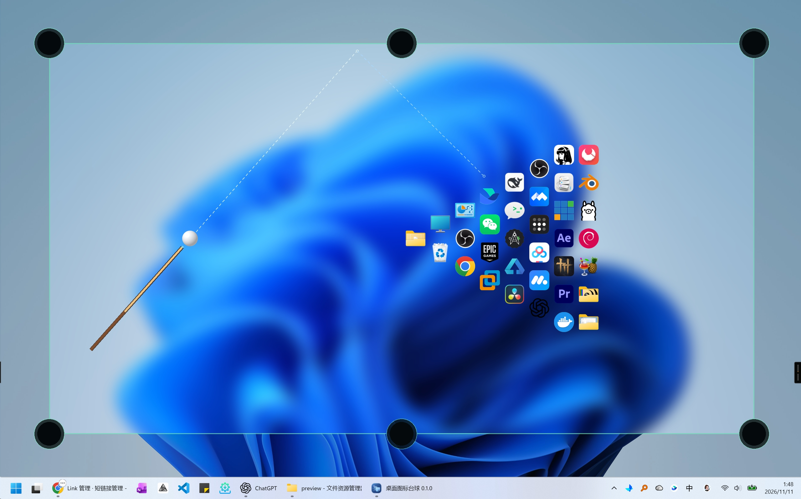
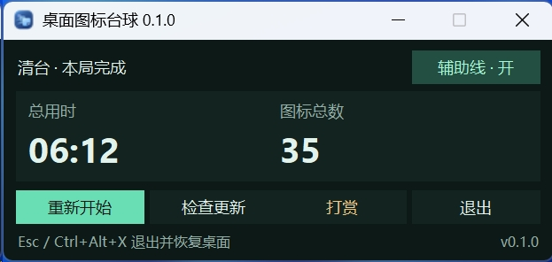
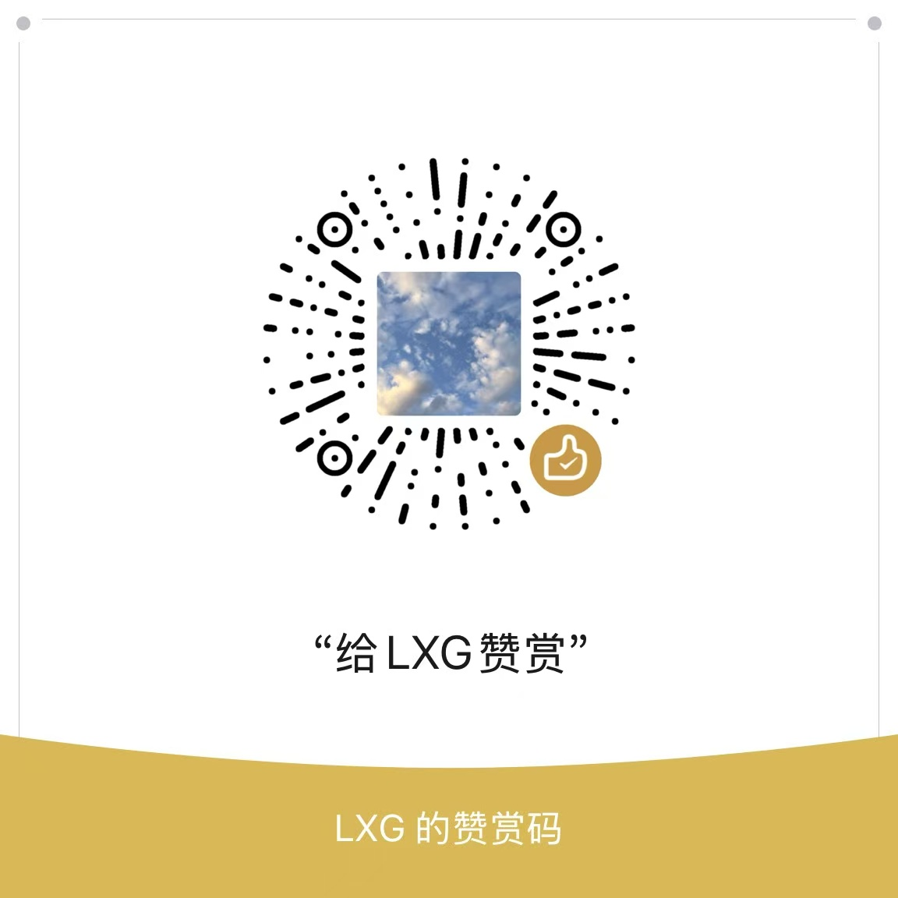

# 桌面图标台球 · Desktop Icon Billiards

**把 Windows 桌面图标摆成一局台球。** 在桌面上移动鼠标瞄准，按住左键蓄力，松手击球。图标保留自己的缩略图，会滚动、碰撞和入袋。退出后，桌面恢复原样。

Windows 10 / 11 x64 · 单文件 EXE · MIT



## 下载

Windows 版 v0.1.2 为单文件 EXE。[GitHub 下载](https://github.com/liuxiaogang-com/desktop-icon-billiards/releases/download/v0.1.2/DesktopIconBilliards-0.1.2-win-x64.exe) · [CNB 国内镜像](https://cnb.cool/liuxiaogang/desktop-icon-billiards/-/releases/download/v0.1.2/DesktopIconBilliards-0.1.2-win-x64.exe)

`desktop-icon-billiards` 的源码和发布附件在两个平台同步。[GitHub 仓库](https://github.com/liuxiaogang-com/desktop-icon-billiards) · [CNB 国内镜像仓库](https://cnb.cool/liuxiaogang/desktop-icon-billiards)

官网入口为 [桌面图标台球](https://go.liuxiaogang.com/zmtq)。

## 玩法

1. 启动后等桌面图标摆好。移动鼠标选择白球的出球方向，**按住左键蓄力，松手击球**。按下的位置旁会显示「力度」进度条。
2. 用「**辅助线 · 开 / 关**」切换瞄准辅助。白线标记首次碰撞前的路线，蓝线表示白球碰球或碰库后的方向，绿线表示被撞图标的方向。路线会随力度变化，终点是预计的下一次碰撞、入袋或停球位置。
3. 主窗口显示本局用时、进球数和剩余图标数。白球入袋时会尝试自动摆回，如果没有合适的位置，可以点击台面空处摆球。白球入袋不计入进球数。
4. 清台后查看总用时和图标总数。点击「**重新开始**」重置本局，也可以在中途重开。
5. 点击「退出」、按 `Esc` 或使用全局快捷键 `Ctrl+Alt+X`，恢复桌面。



## 从源码运行

需要 Windows 10 / 11 x64、Explorer 桌面和 Python 3.11+（含 Tk）。下面用 [uv](https://docs.astral.sh/uv/) 安装 Python 3.12 和运行依赖。

```powershell
uv venv --managed-python --python 3.12 .venv
uv pip install --python .\.venv\Scripts\python.exe -r requirements.txt
.\run.cmd
```

环境准备好后，也可以双击 `run.cmd`。如果双击后没有窗口，从 PowerShell 运行 `.\.venv\Scripts\python.exe -X utf8 app.pyw` 查看错误。若访问 Explorer 时遇到「拒绝访问」，请在当前登录用户的普通桌面会话运行。使用 Microsoft Store 版 Python 创建过虚拟环境时，可移走旧的 `.venv` 后按上面的命令重建。

## 构建与测试

打包需要 PowerShell 7 和 uv。

```powershell
pwsh -File build.ps1
```

产物位于 `dist/DesktopIconBilliards-<version>-win-x64.exe`，可以直接运行。脚本会输出大小和 SHA-256，版本号取自 `dib/__init__.py`。已安装构建依赖时，可加 `-SkipDeps`。

```powershell
.\.venv\Scripts\python.exe -m unittest discover -s tests -t . -v
```

- [更新源格式和发布步骤](docs/UPDATE.md)
- [示例更新清单](update.example.json)
- 图标原图位于 `assets/desktop-icon-billiards.png`。修改后运行 `.\.venv\Scripts\python.exe tools\make_icon.py`，生成七种尺寸的 Windows ICO。

## 桌面与隐私

游戏通过 Windows Shell 读取桌面图标的缩略图和布局，用独立的桌面图层绘制游戏画面。台面内的高斯模糊来自本地壁纸文件。游戏不截取桌面画面，也不采集音频。

退出时会恢复桌面，独立看门狗也会在游戏进程异常退出后尝试恢复。运行记录位于 `%TEMP%\DesktopIconBilliards`。游戏期间若更改分辨率、DPI 或屏幕布局，本局会停止并恢复桌面。桌面图标需处于显示状态，同一时间只运行一个实例。

## 打赏

如果你喜欢这个项目，可以用微信扫码赞赏。感谢支持！



[打开赞赏图片](assets/donation.jpg)

## 许可证

[MIT](LICENSE) · Copyright (c) 2025–2026 LXG
